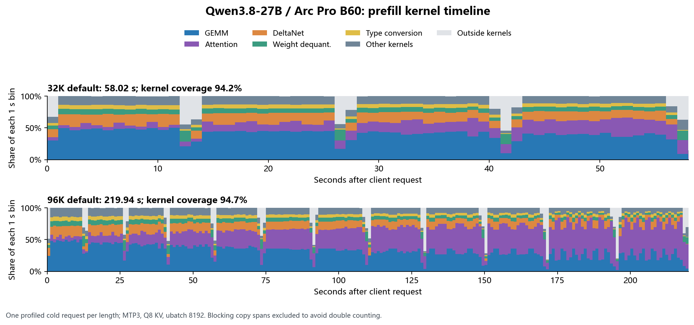

# Qwen3.8-27B：B60 预填充算子时间线

后续：[分块 GDN 改进](qwen38-kernel-experiments.md)已实测并采用；以下保留最初的瓶颈定位与参数对照。

2026-10-25，Windows / SYCL / 当前混合 IQ 权重。**长上下文最值得改进的是注意力内核；这轮两个参数对照没有带来明显提速，默认配置保持不变。**

[逐次计时](../results/2026-10-25-qwen38-profile/measurements.csv) · [版本与采集局限](../results/2026-10-25-qwen38-profile/metadata.json) · [32K 分析](../results/2026-10-25-qwen38-profile/32k-default/analysis.json) · [96K 分析](../results/2026-10-25-qwen38-profile/96k-default/analysis.json)



图中每根柱子把一个 1 秒窗口内的内核时长按类别相加，不表示窗口内算子的先后次序；最后一个窗口不足 1 秒。精确先后、重叠、CPU 调用和依赖关系保存在完整 trace 中。

## 实际时间花在哪里

| 执行类别 | 32K：秒 / 请求占比 | 96K：秒 / 请求占比 |
|---|---:|---:|
| oneDNN GEMM 矩阵乘 | 23.26 / 40.1% | 69.79 / 31.7% |
| 完整注意力相关内核 | 8.81 / 15.2% | **70.86 / 32.2%** |
| Gated DeltaNet | 8.05 / 13.9% | 24.05 / 10.9% |
| 权重解量化 | 4.43 / 7.6% | 13.47 / 6.1% |
| 类型转换 | 3.12 / 5.4% | 9.38 / 4.3% |
| 其他内核 | 6.97 / 12.0% | 20.66 / 9.4% |
| 不在内核执行区间内的时间 | 3.39 / 5.8% | 11.74 / 5.3% |
| 客户端请求总时长 | **58.02** | **219.94** |

这里采集的请求只生成 1 token，目的是隔离预填充；不是检索正确性或生成能力测试。两组都保持 MTP3、Q8 KV、context 114,688、主 batch/ubatch 8192、草稿 ubatch 512；cache_n=0，输入分别为 32,768 和 98,304 个已保存的相同 token。

**32K→96K：GEMM、解量化和 DeltaNet 基本增长 3 倍，注意力增长约 8 倍。** 注意力逐渐占据更大的时间份额，与这个模型的 16 层完整注意力结构相符。

GPU 内核执行区间的并集覆盖请求的约 94%–95%。这说明这两次请求的大部分时间都在执行 GPU 内核，**不是硬件 XMX 利用率，也不能证明已接近硬件极限**。这些内核包含向量、循环状态、转换和内存受限工作，不能全部用 FP16 XMX 峰值折算。

仅作量级核对：主投影约 48.7 GFLOP/token，乘以 32K 再除以 GEMM 的约 23 秒，折算约 69 TFLOPS。这个估算没有把 GEMM 内部工作与其他矩阵计算逐一分离，不能替代硬件计数器；但它说明“整段预填充仅为理论上界三成”不等于“大矩阵乘还有三倍收益”。

## 两个直接对照

以下都是同一个 32K token 数组、同一运行库、MTP 开启的采集请求；除注明项外配置相同。

| 配置 | 预填充秒 | tok/s | 观察 |
|---|---:|---:|---|
| 默认：oneDNN 注意力、ubatch8192 | 58.00 | 565 | 参考 |
| 关闭 oneDNN 注意力，转 MKL 路径 | 63.15 | 519 | 慢约 8.9%，不采用 |
| 主 batch/ubatch12288 | 57.15 | 573 | 只少约 0.85 秒，未确认可重复收益，不采用 |

关闭 oneDNN 后，实际走的是 MKL 注意力流水线；**目录名 native-attention 不表示纯 TILE/VEC 内核**。其中 MKL GEMM 与注意力辅助核合计约 14.08 秒，默认注意力约 8.81 秒，解释了大部分退化。分析脚本将 MKL GEMM 单列，避免混入主模型 GEMM。

主批量12288使解量化约少 0.95 秒，但注意力约多 0.66 秒；没有出现整体大幅提速。采样专用显存最大观察值从约 **20.55 GiB** 增至 **22.67 GiB**，共享占用观察值都约 118 MiB。采样不连续覆盖整个请求，不能当成真实峰值或页面迁移证据。该配置只做了 32K 一次采集，没有把这个小差异外推到 96K。

本轮开始时，默认32K不加采集器的同输入请求为 **57.53 秒 / 570 tok/s**；采集后58.00秒，耗时增加约 **0.82%**。96K采集为219.75秒，接近此前同输入的218.85秒，但本轮没有新的96K成对无采集对照，不能把差额作为严格的96K采集开销测量。

## 如何理解理论上界与优化空间

[理论估算](qwen38-prefill-ceiling.md)假定所计工作始终达到 FP16 XMX 峰值，且省略了 DeltaNet 状态计算、转换、激活和其他实际成本。此次时间线补上了这些实际开销，不能继续用理论值直接承诺三倍提速。

可以用条件计算安排工作优先级：

- 若96K注意力快一倍，其他时间不变，约能省 **35秒**。
- 若DeltaNet也快一倍，再约省 **12秒**。
- 两者同时实现，219.9秒约可降到172.5秒。**这是条件算例，不是测得或保证能达到的结果。**

下一步应围绕长上下文 SDPA 和支持 MTP 回滚状态的分块 GDN 内核做实现/框架对照。当前 [SYCL GDN 源码](https://github.com/ggml-org/llama.cpp/blob/d327bf1f0780f87b8c01b367b61853b0c291d7c4/ggml/src/ggml-sycl/gated_delta_net.cpp)仍以 token 循环实现，并留有 chunked prefill 的 TODO。改它必须保留 MTP 所需的状态快照，不能以关闭或破坏回滚来换速度。融合类型转换和激活也值得后续检查。仅减小模型文件或继续堆 batch，没有证据表明会带来大幅收益。

## 采集方法和复现

使用 [Intel unitrace](https://github.com/intel/pti-gpu/tree/307d457292976823546d3b30b141402de44f724f/tools/unitrace)，显示版本2.4.1，源 commit `307d457292976823546d3b30b141402de44f724f`。在本机编译 Level Zero 跟踪器，未启用 XPTI/ITT/OpenCL/MPI/OMP，也没有采硬件频率、功耗、带宽、XMX占用率或停顿计数器。推理 DLL 与前次测试哈希一致，未打新推理补丁。

每次采集先确认服务没有活跃请求，停止有记录且可执行文件匹配的服务，以同参数启动到隐藏的独立 console。模型加载、工作集整理和4096-token热身期间暂停采集，只在冷请求前恢复；请求结束后暂停，向这一个 console 发送 Ctrl-C 正常退出，以便写出 trace，最后恢复默认服务。该生命周期已在本机四次完成；也保存了不采用的对照。

```powershell
# 编译器、VS 2022 Community 与部署目录的 oneAPI 需先安装，参见安装文档。
git clone https://github.com/intel/pti-gpu.git C:/MyLLM/nemotron-sycl/toolchain/pti-gpu
git -C C:/MyLLM/nemotron-sycl/toolchain/pti-gpu checkout 307d457292976823546d3b30b141402de44f724f
./scripts/build_unitrace.cmd C:/MyLLM/nemotron-sycl

# 用常规 bench_chat 产生同长度的已保存合成输入；这里会实际运行一次完整对话测试。
python scripts/bench_chat.py --label fixture32 --output runs/fixture32 --size 32768 --generation-tokens 128 --preset presets/qwen38-recommended.json

# 会重启服务并清空推理缓存；单客户端使用，输出目录必须是新的。
python scripts/profile_prefill.py --deployment-dir C:/MyLLM/nemotron-sycl --prompts runs/fixture32/prompts.json --output runs/profile32 --unitrace C:/MyLLM/nemotron-sycl/toolchain/build-unitrace/unitrace.exe
python scripts/analyze_unitrace.py runs/profile32

# 对照：分别使用新的目录。--skip-baseline 只省略前置无采集测量。
# oneDNN off，MKL fallback：
python scripts/profile_prefill.py --deployment-dir C:/MyLLM/nemotron-sycl --prompts runs/fixture32/prompts.json --output runs/profile32-mkl --unitrace C:/MyLLM/nemotron-sycl/toolchain/build-unitrace/unitrace.exe --skip-baseline --extra-env GGML_SYCL_FA_ONEDNN=0
# 更大主批量：
python scripts/profile_prefill.py --deployment-dir C:/MyLLM/nemotron-sycl --prompts runs/fixture32/prompts.json --output runs/profile32-large --unitrace C:/MyLLM/nemotron-sycl/toolchain/build-unitrace/unitrace.exe --skip-baseline --batch 12288 --ubatch 12288

# 可选显存采样：在另一个终端、采集目录建好后启动；停止时间按实际请求长度设置。
./scripts/sample_gpu_memory.ps1 -OutputPath C:/MyLLM/intel-arc-pro-b60-llm-lab/runs/profile32/gpu-memory.jsonl -Seconds 120 -Interval 2

# 可选绘图需要 matplotlib（含 NumPy 依赖）。
python scripts/plot_unitrace.py results/2026-10-25-qwen38-profile/32k-default results/2026-10-25-qwen38-profile/96k-default --output runs/timeline
python -m unittest discover -s tests -v
python scripts/check_evidence.py --directory results/2026-10-25-qwen38-profile
```

`profile_prefill.py` 面向 Windows、本仓库管理且实际参数与预设一致的单槽服务、可复现的合成提示，采集请求只生成1 token。正常退出使 trace 得以落盘；直接强杀进程可能丢失采集结果。绘图可以直接读快照中的压缩CSV；用 `snapshot_unitrace.py --help` 查看生成新快照的参数。

每组的 `trace.json.gz` 是完整 Chrome trace 的压缩包，解压为JSON后可在 [Perfetto](https://ui.perfetto.dev/) 手动载入。它包含GPU内核、CPU端Level Zero调用和依赖。快照只将机器名改为local，并保留PID/TID供关联；绝对路径已在配置和日志中替换成文件名。未上传任何 trace 到外部服务。

**不要直接相加 API / copy 汇总与内核时间。** 32K表中内存拷贝跨度约53秒，和大部分内核时间重叠；它反映了阻塞调用及等待，不能当成搬运53秒，也不能据此计算实际DMA带宽。分析脚本裁剪到客户端请求时间窗，对GPU内核取区间并集；单元测试专门覆盖了重叠、嵌套、窗口外事件与阻塞拷贝。

历史测试、权重和生产预设均保留。默认服务已恢复为 `0.0.0.0:5001`、主8192/草稿512、Q8 KV、MTP3开启。本轮结果是定位与排除两项参数尝试，**没有确认新的明显预填充收益**。
